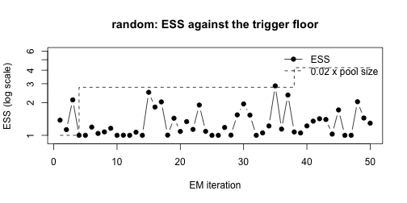

\ifelse{html}{\href{https://lifecycle.r-lib.org/articles/stages.html#experimental}{\figure{lifecycle-experimental.svg}{options: alt='[Experimental]'}}}{\strong{[Experimental]}}

A survey observes a friendship network at a few moments, the waves. Between
two waves, ties form and dissolve one at a time, but the survey records only
the state at each end. A phone log observes calls continuously. A **DyNES**
model treats both as processes of one model: the calls are relational events
observed as they happen, and the friendship network is a relational *state*
whose changes happened at times nobody recorded. `estimate_dynes()` fits it
by **data augmentation**. It draws many possible between-wave paths, each one
a time and an order for the changes, weights them by how likely the current
parameters make them, and maximizes the expected log-likelihood over that
weighted pool (a Monte-Carlo EM algorithm).

This vignette fits such a model to the packaged `social_evolution` data and
then reads the result. The reading is the main subject: an augmented fit has
a Monte-Carlo error on top of the usual standard error, and its diagnostics
answer four separate questions that are easy to run together.


``` r
library(goldfish)
```

# Step 1: From two surveys to a list of changes

`social_evolution` carries two layers over 84 actors: `calls`, a stream of
time-stamped phone calls, and `friendship`, the nominations reported at two
surveys (2008-09-09 and 2008-10-19). See `vignette("teaching1")` for how the
object is assembled.


``` r
se <- social_evolution
ties <- as.data.frame(se$ties)
friendship <- ties[ties$layer == "friendship", ]
waves <- sort(unique(friendship$time))
waves
#> [1] "2008-09-09 GMT" "2008-10-19 GMT"
wave1 <- friendship[friendship$time == waves[1], ]
wave2 <- friendship[friendship$time == waves[2], ]
c(wave1 = nrow(wave1), wave2 = nrow(wave2))
#> wave1 wave2 
#>   376   390
```

## Who can be compared across waves

A survey row says *this person named that person*. An actor with no row at a
wave either named no one or did not answer the survey, and the data cannot
tell the two apart. A tie can only be diffed between two waves for an actor
whose answers exist at both. So the node set is the actors who sent
nominations at both surveys, and every tie touching anyone else is dropped
with them:


``` r
both <- intersect(wave1$from, wave2$from)
omitted_wave1 <- sum(!wave1$from %in% both)
omitted_wave2 <- sum(!wave2$from %in% both)
c(actors = length(both), omitted_wave1 = omitted_wave1,
  omitted_wave2 = omitted_wave2)
#>        actors omitted_wave1 omitted_wave2 
#>            51            28            47

ties <- ties[ties$from %in% both & ties$to %in% both, ]
ties$from <- match(ties$from, both)
ties$to <- match(ties$to, both)
n_actors <- length(both)
```

That keeps 51 actors and drops the 28 wave-1 and 47 wave-2 nominations sent
by actors who answered only one survey. It also drops the nominations the 51
sent to actors outside the set (72 at wave 1, 67 at wave 2). The calls are
restricted to the same 51 actors.

One actor is worth naming. Actor 61 answered both surveys, but both of their
nominations named actors outside the 51, and no one in the 51 names them.
Within the panel they are an isolate at both waves. They stay in the node
set, but they can never dissolve a tie, and they can take part in a
friendship only by creating one.

## The wave diff

With the node set fixed, each survey is a 51 x 51 adjacency matrix, 1 for a
reported friendship:


``` r
friendship <- ties[ties$layer == "friendship", ]
wave1 <- friendship[friendship$time == waves[1], ]
wave2 <- friendship[friendship$time == waves[2], ]
survey_matrix <- function(wave) {
  adjacency <- matrix(0, n_actors, n_actors)
  adjacency[cbind(wave$from, wave$to)] <- 1
  adjacency
}
adjacency1 <- survey_matrix(wave1)
adjacency2 <- survey_matrix(wave2)
table(wave1 = adjacency1, wave2 = adjacency2)
#>      wave2
#> wave1    0    1
#>     0 2255   70
#>     1   70  206
```

A **panel event** is a cell that differs between the two matrices, recorded
at wave 2 with its wave-2 value: 1 for a tie that formed, 0 for one that
dissolved. Cells that agree are not changes of state, so the 206 stable ties
are not listed again.


``` r
cells <- which(adjacency1 != adjacency2, arr.ind = TRUE)
changes <- data.frame(
  from = cells[, "row"],
  to = cells[, "col"],
  time = waves[2],
  weight = adjacency2[cells],
  layer = "friendship"
)
table(changes$weight)
#> 
#>  0  1 
#> 70 70
```

The rows with `weight = 0` are essential. Wave 2 of the raw data lists only
nominations (every row is 1), and goldfish reads a panel layer as a replayed
change-list. Without an explicit 0, a tie that wave 2 no longer reports would
simply keep its wave-1 value.

The panel layer is then wave 1's nominations followed by the 140 changes,
beside the 364 calls among the 51. Wave 1 is the starting network, not a set
of events, so its rows get `time = NA`: a history row sets the state the
first interval starts from. Stamped at the first wave instead, each of the
276 ties would be scored as a creation at the opening of the interval.


``` r
wave1$time <- NA
ties <- rbind(ties[ties$layer == "calls", ], wave1, changes)
ties <- ties[order(ties$time, na.last = FALSE), ]
table(ties$layer)
#> 
#>      calls friendship 
#>        364        416

panel <- se
panel$nodes <- as.data.frame(se$nodes)[both, ]
panel$ties <- ties
```

## The two flavors of a change

A formed tie and a dissolved tie are different decisions, so each gets its
own rate and choice model. `add_flavor()` maps the two values onto flavor
names. `flavor_style = "mutually_exclusive"` also derives the support
constraint: a creation can only target an absent tie, and a dissolution only
a present one.


``` r
panel <- add_flavor(
  panel,
  layer = "friendship",
  values_equivalence = c(creation = 1, dissolution = 0),
  flavor_style = "mutually_exclusive"
)
```

## Count panels

`friendship` is a **state panel**: each cell is 0 or 1, and the diff gives
the net change of each dyad between the waves. A **count panel** records how
many events happened on each dyad over the interval, such as a monthly tally
of calls. Its diff is exact: the counts say how many events occurred, and
only their times are unknown. A state diff is not exact in the same way. A
tie that formed and dissolved again between the waves leaves no trace in the
two matrices. Step 6 comes back to what that means for the estimates. No
packaged dataset carries a count panel, and `calls` stays a stream of events
here, so this vignette fits a state panel only.

# Step 2: The joint specification

Each process gets its own specification, and `make_joint_specification()`
composes them. The friendship process has a rate and a choice model per
flavor. The calls process reads the friendship state: callers with more
friends call more often (`indeg(friendship)`), and they call their friends
(`tie(friendship)`).


``` r
spec <- make_joint_specification(
  make_specification(
    rate = list(creation ~ 1, dissolution ~ 1),
    choice = list(creation ~ recip, dissolution ~ recip),
    layer = "friendship",
    model = "DyNAM",
    data = panel
  ),
  make_specification(
    rate = ~ 1 + indeg(friendship),
    choice = ~ inertia + tie(friendship),
    layer = "calls",
    model = "DyNAM",
    data = panel
  ),
  data = panel
)
```

This specification is **coupled**: the calls observed between the waves
depend on the friendship state at the moment of each call, so they carry
information about when the friendships changed.

The clock is the data's own (`POSIXct`, in seconds), so every rate is a rate
per second.

# Step 3: What augmentation draws

Before fitting, it helps to see what one augmented path looks like. Nothing
exported draws a path outside a fit, so the next chunks call goldfish
**internals** (`goldfish:::`). They are shown for illustration only. These
functions are not part of the API and may change without notice.

Every evaluation of a path also re-runs the support-constraint check, which
warns about the same facts each time. The helper below records those warnings
instead of printing hundreds of copies. Every other warning still prints.


``` r
support_seen <- character()
quiet_support <- function(expr) {
  withCallingHandlers(
    expr,
    warning = function(w) {
      if (grepl("support_constraint", conditionMessage(w), fixed = TRUE)) {
        support_seen <<- union(support_seen, conditionMessage(w))
        invokeRestart("muffleWarning")
      }
    }
  )
}
```

`estimate_dynes()` compiles the panel into a **recipe** of latent flips. Each
flip has a known dyad and direction but an unknown time:


``` r
wave_times <- as.numeric(waves)
prep <- set_preprocessing(start_time = wave_times[1], end_time = wave_times[2])
completed <- quiet_support(suppressWarnings(goldfish:::complete_generative_spec(
  goldfish:::snap_composition_to_waves(spec, wave_times),
  consumer = "estimate_dynes",
  wave_times = wave_times
)))
recipe <- goldfish:::compile_augmentation_recipe(completed, wave_times)
labels <- panel$nodes$label
as_time <- function(x) as.POSIXct(x, origin = "1970-01-01", tz = "UTC")

flips <- recipe$events
flips$sender <- labels[flips$from]
flips$receiver <- labels[flips$to]
table(flips$flavor)
#> 
#>    creation dissolution 
#>          70          70
```

The `suppressWarnings()` around the completion silences its announcement
that the specification has been completed: here it pins nothing a reader
needs to see.

## A `random` draw

The `random` augmenter gives every flip a uniform time in the interval and
so draws a uniform order:


``` r
control <- set_algorithm_em(
  seed = 2008L,
  augmenter = set_augmenter_options(routine = "random")
)
set.seed(2008)
random <- goldfish:::augment_seq_random(
  completed,
  recipe,
  control,
  control_prep = prep
)
draw <- random$draw(1L, 1L, theta = NULL)[[1]]
sequence <- as.data.frame(draw$data$ties)
drawn <- sequence[
  sequence$layer == "friendship" & sequence$time > wave_times[1],
]
drawn$time <- as_time(drawn$time)
drawn$sender <- labels[drawn$from]
drawn$receiver <- labels[drawn$to]
head(drawn[c("time", "sender", "receiver", "flavor")], 8)
#>      time sender receiver flavor
#> NA   <NA>   <NA>     <NA>   <NA>
#> NA.1 <NA>   <NA>     <NA>   <NA>
#> NA.2 <NA>   <NA>     <NA>   <NA>
#> NA.3 <NA>   <NA>     <NA>   <NA>
#> NA.4 <NA>   <NA>     <NA>   <NA>
#> NA.5 <NA>   <NA>     <NA>   <NA>
#> NA.6 <NA>   <NA>     <NA>   <NA>
#> NA.7 <NA>   <NA>     <NA>   <NA>
```

That is one complete path: 140 flips, each with a time, slotted among the
observed calls.

## MCMC moves on that draw

The `mcmc` augmenter starts from such a path and changes it one move at a
time. A **permute** exchanges the places of two flips on different dyads; a
**shift** moves one flip to a new time. A move is accepted with the
Metropolis-Hastings probability, whose log is `log alpha` below: the change
in the path's log-likelihood under the current parameters, plus the proposal
correction.

The chain needs parameters. A rough start sets each rate intercept to the
observed mean rate per actor and second and every other effect to 0. Leaving
the intercepts at 0 would mean one event per second, and a shifted flip would
land about a second after its anchor.


``` r
layout <- coef_layout(completed)[!coef_layout(completed)$fixed, ]
seconds <- diff(wave_times)
n_events <- c(
  "friendship › creation › rate" = 70,
  "friendship › dissolution › rate" = 70,
  "calls › rate" = sum(panel$ties$layer == "calls")
)
theta0 <- ifelse(
  layout$name == "Intercept",
  log(n_events[layout$process] / (length(labels) * seconds)),
  0
)
data.frame(process = layout$process, effect = layout$name, theta0)
#>                             process           effect    theta0
#> 1      friendship › creation › rate        Intercept -14.73895
#> 2    friendship › creation › choice recip/friendship   0.00000
#> 3   friendship › dissolution › rate        Intercept -14.73895
#> 4 friendship › dissolution › choice recip/friendship   0.00000
#> 5                      calls › rate        Intercept -13.09029
#> 6                      calls › rate indeg/friendship   0.00000
#> 7                    calls › choice    inertia/calls   0.00000
#> 8                    calls › choice   tie/friendship   0.00000
```


``` r
new_chain <- function(theta) {
  chain <- goldfish:::new_mcmc_chain(
    goldfish:::new_augmenter_context(completed, recipe, prep),
    set_algorithm_em(augmenter = set_augmenter_options(routine = "mcmc"))
  )
  goldfish:::mcmc_start(
    chain,
    goldfish:::mcmc_times_from_data(chain$context, draw$data)
  )
  attach_theta(chain, theta)
  chain
}
attach_theta <- function(chain, theta) {
  quiet_support(goldfish:::mcmc_attach(
    chain,
    goldfish:::make_proposal_evaluator(
      goldfish:::decompose_joint_spec(completed),
      theta,
      spec = completed,
      control_prep = prep
    )
  ))
}
show_move <- function(step) {
  moved <- which(step$current != step$proposed)
  cat(sprintf(
    "%s move: log alpha = %.2f, %s\n",
    step$move$type,
    step$log_alpha,
    if (step$accepted) "accepted" else "rejected"
  ))
  print(
    data.frame(
      sender = flips$sender[moved],
      receiver = flips$receiver[moved],
      flavor = flips$flavor[moved],
      before = as_time(step$current[moved]),
      after = as_time(step$proposed[moved])
    ),
    row.names = FALSE
  )
}
```

First with every effect but the intercepts at 0. One accepted permute and one
accepted shift:


``` r
chain <- quiet_support(new_chain(theta0))
set.seed(1)
for (type in c("permute", "shift")) {
  repeat {
    step <- quiet_support(
      goldfish:::mcmc_step(chain, goldfish:::mcmc_pick_move(chain))
    )
    if (identical(step$move$type, type) && isTRUE(step$accepted)) break
  }
  show_move(step)
}
#> permute move: log alpha = 0.00, accepted
#>    sender receiver      flavor              before               after
#>  Actor 18 Actor 28 dissolution 2008-10-02 23:41:51 2008-09-18 05:19:15
#>  Actor 73 Actor 47 dissolution 2008-09-18 04:44:27 2008-10-02 22:52:06
#> shift move: log alpha = 0.00, accepted
#>    sender receiver   flavor              before               after
#>  Actor 11  Actor 7 creation 2008-10-09 13:29:09 2008-10-09 17:36:23
```

With no effect active, the order of two dissolutions, or the exact time of a
creation, does not change the path's likelihood, so `log alpha` is 0 and
the move is accepted. Here `random` already draws from the target.

That is not true of every move, even here. A permute can pair any two flips
of the interval on different dyads, whatever their flavors. Swapping a
creation with a dissolution changes the state in between, and with it who is
at risk of dissolving a tie, so `log alpha` moves off 0 with every effect
still at 0:


``` r
catalog <- goldfish:::mcmc_move_catalog(recipe)
mixed <- catalog$pairs[
  flips$flavor[catalog$pairs$first] != flips$flavor[catalog$pairs$second],
][1, ]
show_move(quiet_support(goldfish:::mcmc_step(
  chain,
  list(type = "permute", events = c(mixed$first, mixed$second))
)))
#> permute move: log alpha = 0.18, accepted
#>    sender receiver      flavor              before               after
#>  Actor 47 Actor 68    creation 2008-10-01 20:17:14 2008-10-13 15:30:12
#>  Actor 57 Actor 63 dissolution 2008-10-13 18:45:47 2008-10-01 18:09:30
```

Now the same moves with every effect set to 1, so that reciprocity, the
friendship statistics of the calls, and the order of the flips all matter:


``` r
theta1 <- ifelse(layout$name == "Intercept", theta0, 1)
attach_theta(chain, theta1)
set.seed(2)
for (i in 1:3) {
  show_move(quiet_support(
    goldfish:::mcmc_step(chain, goldfish:::mcmc_pick_move(chain))
  ))
}
#> permute move: log alpha = 114.72, accepted
#>    sender receiver   flavor              before               after
#>  Actor 11 Actor 57 creation 2008-09-17 08:09:25 2008-09-14 10:54:45
#>  Actor 46 Actor 32 creation 2008-09-14 12:42:42 2008-09-17 11:55:07
#> permute move: log alpha = 14024.65, accepted
#>    sender receiver   flavor              before               after
#>  Actor 52 Actor 31 creation 2008-09-22 04:18:28 2008-10-07 15:06:27
#>  Actor 71 Actor 60 creation 2008-10-07 20:40:42 2008-09-22 07:05:30
#> permute move: log alpha = -930.94, rejected
#>    sender receiver      flavor              before               after
#>  Actor 57 Actor 24    creation 2008-09-24 14:10:41 2008-09-21 20:59:48
#>   Actor 9 Actor 53 dissolution 2008-09-21 19:48:28 2008-09-24 17:09:04
```

Some moves are rejected now, and the accepted ones have large `log alpha`.
One full sweep proposes as many moves as there are flips:


``` r
chain$counts$proposals[] <- 0L
chain$counts$accepted[] <- 0L
sweep_time <- system.time(
  quiet_support(goldfish:::mcmc_sweeps(chain, 1L))
)[["elapsed"]]
goldfish:::mcmc_diagnostics(chain)[c("proposals", "accepted", "acceptance_rate")]
#> $proposals
#> permute   shift 
#>      73      67 
#> 
#> $accepted
#> permute   shift 
#>      35      38 
#> 
#> $acceptance_rate
#> [1] 0.5214286
```

The sweep took 48 seconds on one core, mostly in the
likelihood evaluations of the proposed paths. An EM iteration under `mcmc`
runs tens of sweeps, which is why the fits below were run on a cluster.

These are the support-constraint warnings that every evaluation raised and
`quiet_support()` recorded:


``` r
cat(support_seen, sep = "\n\n")
#> ! `support_constraint`: 1 present sender never at risk (always gated out).
#> ℹ Node: 51.
#> 
#> ! `support_constraint`: 2 receivers present at some event, never an allowed
#>   candidate.
#> ℹ Nodes: 15 and 51.
#> 
#> ! `support_constraint`: 1 present sender allowed no receiver at any event.
#> ℹ Node: 51.
#> 
#> ! `support_constraint`: 1 event with a single candidate (forced choice;
#>   contributes 0 to the log-likelihood).
#> ℹ Event: 57.
#> 
#> ! `support_constraint`: 3 receivers present at some event, never an allowed
#>   candidate.
#> ℹ Nodes: 15, 18, and 51.
#> 
#> ! `support_constraint`: 1 event with a single candidate (forced choice;
#>   contributes 0 to the log-likelihood).
#> ℹ Event: 58.
#> 
#> ! `support_constraint`: 1 event with a single candidate (forced choice;
#>   contributes 0 to the log-likelihood).
#> ℹ Event: 59.
#> 
#> ! `support_constraint`: 1 event with a single candidate (forced choice;
#>   contributes 0 to the log-likelihood).
#> ℹ Event: 60.
#> 
#> ! `support_constraint`: 1 event with a single candidate (forced choice;
#>   contributes 0 to the log-likelihood).
#> ℹ Event: 61.
#> 
#> ! `support_constraint`: 1 event with a single candidate (forced choice;
#>   contributes 0 to the log-likelihood).
#> ℹ Event: 62.
#> 
#> ! `support_constraint`: 1 event with a single candidate (forced choice;
#>   contributes 0 to the log-likelihood).
#> ℹ Event: 63.
labels[c(15, 18, 51)]
#> [1] "Actor 64" "Actor 52" "Actor 61"
```

Node 51 is Actor 61, the isolate of Step 1. No one is at risk of dissolving
a tie they do not have. Nodes 15 and 18 are never named by anyone in the
panel, so they are never a candidate for a dissolution either. A forced choice
is an actor with a single tie left to dissolve: the choice has one candidate
and adds nothing to the log-likelihood. All of these warnings describe the
data, not a fault in it.

# Step 4: Fitting the model

`estimate_dynes()` takes the joint specification, the EM controls and the
wave times. The two fits below differ only in the augmenter:


``` r
fit_random <- estimate_dynes(
  spec,
  set_algorithm_em(
    n_sequences = 50L,
    seed = 2008L,
    augmenter = set_augmenter_options(routine = "random", warm_start = TRUE)
  ),
  wave_times = waves
)
fit_mcmc <- estimate_dynes(
  spec,
  set_algorithm_em(
    n_sequences = 50L,
    seed = 2008L,
    augmenter = set_augmenter_options(routine = "mcmc", warm_start = TRUE)
  ),
  wave_times = waves
)
```

`n_sequences = 50` is the starting pool size `K`. `warm_start = TRUE` draws
one path, fits the model on it as if it were observed, and starts EM from
those estimates instead of from 0. The M-step runs the default
`set_sgd_options()`, and EM stops after at most 50 iterations
(`max_iterations`, the default).

The fits are not run while this vignette is built. On one core, `random` took
1.7 hours and `mcmc` 12.7 hours. They were run once and saved, and the
vignette reads them:


``` r
round(c(
  random = saved_random$elapsed[["elapsed"]],
  mcmc = saved_mcmc$elapsed[["elapsed"]]
) / 3600, 1)
#> random   mcmc 
#>    1.7   12.7
```

# Step 5: Reading the fits


``` r
summary(fit_mcmc)
#> ── <goldfishSummDynesFit> ──────────────────────────────────────────────────────
#> ✔ Converged after 6 accepted EM iterations.
#> ✔ At the final pool's optimum: Newton step 0.043 standard errors.
#> 
#> friendship › creation › rate
#>              Estimate  Std. Error    MC Error z-value  Pr(>|z|)
#> Intercept -1.4739e+01  1.1952e-01  8.3081e-18 -123.31 < 2.2e-16
#> 
#> friendship › creation › choice
#>                  Estimate Std. Error MC Error z-value  Pr(>|z|)
#> recip/friendship 3.018980   0.347028 0.010372  8.6995 < 2.2e-16
#> 
#> friendship › dissolution › rate
#>              Estimate  Std. Error    MC Error z-value  Pr(>|z|)
#> Intercept -1.4716e+01  1.1960e-01  4.4506e-04 -123.04 < 2.2e-16
#> 
#> friendship › dissolution › choice
#>                   Estimate Std. Error  MC Error z-value  Pr(>|z|)
#> recip/friendship -1.491286   0.366717  0.017605 -4.0666 4.771e-05
#> 
#> calls › rate
#>                     Estimate  Std. Error    MC Error z-value  Pr(>|z|)
#> Intercept        -14.9310772   0.1852324   0.0087921 -80.607 < 2.2e-16
#> indeg/friendship   0.2920365   0.0248507   0.0013251  11.752 < 2.2e-16
#> 
#> calls › choice
#>                 Estimate Std. Error  MC Error z-value  Pr(>|z|)
#> inertia/calls  4.0559131  0.2008654 0.0029290  20.192 < 2.2e-16
#> tie/friendship 2.9557952  0.2289166 0.0050682  12.912 < 2.2e-16
#> 
#> MC Error is the Monte-Carlo error of the estimate from the final pool of 121
#> augmented sequences.
#> Largest fraction of missing information: 0.276.
#> Covariance effective sample size: 97.7.
```

The table reads like any coefficient table, with one extra column. **Std.
Error** is the statistical uncertainty of the estimate: how much it would vary
with new data. **MC Error** is the Monte-Carlo uncertainty: how much it would
vary if the same data were fitted again with a fresh pool of augmented paths.
The first is a property of the data and the model. The second is a property
of the fit, and it shrinks as the pool grows.

The calls coefficients carry the substantive result: callers with more
friends in the panel call more often, and calls go to friends and to past
call partners. In the friendship process, a tie that is reciprocated is more
likely to be created and less likely to be dissolved.

Before reading any of that, check four things, and keep them apart. They
answer different questions, and a fit can pass any one of them and fail
another.


``` r
rbind(random = glance(fit_random), mcmc = glance(fit_mcmc))[
  c("converged", "iterations", "at_optimum", "newton_se", "n_sequences")
]
#> # A tibble: 2 × 5
#>   converged iterations at_optimum newton_se n_sequences
#>   <lgl>          <int> <lgl>          <dbl>       <int>
#> 1 FALSE             50 TRUE          0.0933         211
#> 2 TRUE               6 TRUE          0.0430         121
```

## 1. `converged`: did the EM stop rule fire?

`converged` reports whether EM stopped because its stop rule was met, or
because it ran out of iterations. The `mcmc` fit converged after 6 accepted
iterations. The `random` fit did not: it reached `max_iterations` (50) with
every iteration accepted but the stop rule never met, and it returned its
last accepted estimates with a warning.

## 2. `at_optimum`: is the estimate at its pool's optimum?

`at_optimum` and `newton_se` ask a narrower question: given the final pool,
did the M-step reach the maximum of the weighted log-likelihood? `newton_se`
is the length of one more Newton step, in standard errors. Both fits are at
their optimum (0.09 standard errors for `random`, 0.04 for `mcmc`). For `random` that is no
reassurance: an optimum over a pool that represents the posterior badly is
still an optimum.

## 3. The ESS trigger: is the proposal far from the target?

The **effective sample size** (ESS) of the importance weights says how many
of the pool's paths actually carry the estimate. A pool of 50 equally
weighted paths has ESS 50; a pool where one path holds all the weight has ESS
1. `em_trace` records it at every pass:


``` r
trace_random <- fit_random$em_trace
trace_random[c(1:6, 36:40), c("iteration", "pool_size", "ess")]
#> # A tibble: 11 × 3
#>    iteration pool_size   ess
#>        <int>     <int> <dbl>
#>  1         1        50  1.38
#>  2         2        50  1.13
#>  3         3        50  2.13
#>  4         4       139  1.00
#>  5         5       139  1.00
#>  6         6       139  1.19
#>  7        36       139  1.14
#>  8        37       139  2.36
#>  9        38       211  1.07
#> 10        39       211  1.05
#> 11        40       211  1.22
```

Under `random` the weights collapsed from the first pass: ESS between 1 and 3
throughout, on pools of 50, 139 and 211. One path carries the estimate
at almost every iteration.

goldfish turns this into a runtime **trigger**. When, at the opening of an EM
iteration after the first, the ESS falls below **0.02 of the pool**, an
importance-weighted run (`random` or `sim`) gets one warning recommending a
switch to `routine = "mcmc"`. The floor was set from a simulation study of
2,040 fits. Under `random` it stayed silent in 0–4% of fits in every setting
where the routine converged, and fired in 75–100% of fits where it failed,
with or without a coupled event layer. This fit raised it once, when its pool
had grown to 139:


``` r
cat(grep("collapsed mid-run", saved_random$conditions, value = TRUE))
#> ! Effective sample size 1 has collapsed mid-run under the importance-weighted
#>   `routine` = "random" (pool size 139); redrawing cannot recover it.
#> ℹ With many changes per interval the importance-weight variance grows with the
#>   sequence-space dimension, a cost no redraw at any parameters removes.
#> ℹ Switch to `augment_seq_mcmc()`, which does not pay the importance-sampling
#>   dimension tax.
```


``` r
plot(
  trace_random$iteration,
  trace_random$ess,
  type = "b",
  pch = 19,
  log = "y",
  ylim = c(0.9, 6),
  xlab = "EM iteration",
  ylab = "ESS (log scale)",
  main = "random: ESS against the trigger floor"
)
lines(
  trace_random$iteration,
  0.02 * trace_random$pool_size,
  type = "s",
  lty = 2
)
legend(
  "topright",
  c("ESS", "0.02 x pool size"),
  lty = c(1, 2),
  pch = c(19, NA),
  bty = "n"
)
```

<div class="figure">

<p class="caption">plot of chunk ess-plot</p>
</div>

**The floor cannot fire at the starting pool.** At `K = 50` it equals 1,
which is the lowest ESS any pool can have, so the trigger stays silent until
the pool grows beyond 50. That is what happened here over the first three
iterations. A run in which the pool never grows gets no recommendation,
however far its weights have collapsed. In the simulation study, `sim` on the
densest panels sat at ESS 1.00 of 50 on every pass and was never warned.
`random` here did get a different, earlier warning, at the very first pass:
a startup ESS below 5 for a pool of 50 flags a proposal far from the target
at the starting parameters. That check runs only once. So read the `ess`
column of `em_trace` yourself: values near 1 mean the weights have
collapsed, whatever the trigger said. An absolute floor that would also cover
the starting pool is left to a later version.

ESS is a property of the *proposal*, not a verdict on the estimate. A coupled
specification can score low on it because its posterior is sharp: the calls
pin down the friendship path so tightly that few uniform draws resemble it.
That is a reason to switch augmenter, not proof that the estimates are wrong.
The verdict is the next check.

ESS says nothing once you have switched. Under `mcmc` the pool is drawn from
the chain at the current parameters, so the weights start out nearly equal:


``` r
fit_mcmc$em_trace[c("iteration", "retry", "decision", "pool_size", "ess")]
#> # A tibble: 7 × 5
#>   iteration retry decision pool_size   ess
#>       <int> <int> <chr>        <int> <dbl>
#> 1         1     0 accept          50  50  
#> 2         2     0 accept          50  50  
#> 3         3     0 accept          50  50  
#> 4         4     0 accept          50  43.7
#> 5         5     0 accept          71  57.3
#> 6         6     0 accept         121  98.7
#> 7         7     0 stop           121  97.7
```

For `mcmc`, the diagnostics are the chain's **acceptance rate** and the
**autocorrelation** of its draws:


``` r
chain_diagnostics <- fit_mcmc$em_trace$chain_diagnostics
data.frame(
  iteration = fit_mcmc$em_trace$iteration,
  acceptance = vapply(
    chain_diagnostics,
    function(d) if (is.null(d)) NA_real_ else d$acceptance_rate,
    numeric(1)
  ),
  autocorrelation = fit_mcmc$em_trace$autocorrelation
)
#>   iteration acceptance autocorrelation
#> 1         1  0.8148810       0.2896669
#> 2         2  0.7945238       0.5680254
#> 3         3  0.7780159       0.6092946
#> 4         4  0.7780159       0.6185431
#> 5         5  0.7725118       0.7113507
#> 6         6  0.7645756       0.7037846
#> 7         7  0.7645756       0.0000000
```

An acceptance rate near 0 or 1, or an autocorrelation near 1, means the pool's
paths are close copies of each other, and its size overstates the
information it holds.

## 4. The verdict: Monte-Carlo error against standard error

The question that matters in the end is whether the Monte-Carlo error is
small next to the statistical one. The **error ratio** is MC error / standard
error per coefficient:


``` r
error_ratio <- function(fit) {
  tidied <- tidy(fit)
  stats::setNames(tidied$mc.error / tidied$std.error, tidied$term)
}
round(cbind(random = error_ratio(fit_random), mcmc = error_ratio(fit_mcmc)), 3)
#>                                                     random  mcmc
#> friendship › creation › rate: Intercept              0.000 0.000
#> friendship › creation › choice: recip/friendship     0.225 0.030
#> friendship › dissolution › rate: Intercept           0.004 0.004
#> friendship › dissolution › choice: recip/friendship  0.201 0.048
#> calls › rate: Intercept                              0.446 0.047
#> calls › rate: indeg/friendship                       0.498 0.053
#> calls › choice: inertia/calls                        0.206 0.015
#> calls › choice: tie/friendship                       0.250 0.022
```

In the simulation study, converged fits kept this ratio at or below 0.2. In
the coupled specifications it was 5 to 10 times larger than in the uncoupled
ones, so a coupled fit reaches its envelope sooner. Read the ratio among
converged fits. Here the `mcmc` fit is at or below 0.06 on every coefficient.
The `random` fit is above 0.2 on six of its eight coefficients and reaches
0.5 on the calls rate, and it did not converge either.

The two fits do not agree, and the gap is not small:


``` r
compare <- data.frame(
  random = coef(fit_random),
  mcmc = coef(fit_mcmc),
  se_mcmc = sqrt(diag(vcov(fit_mcmc)))
)
compare$gap_in_se <- (compare$random - compare$mcmc) / compare$se_mcmc
round(compare, 3)
#>                                                      random    mcmc se_mcmc
#> friendship › creation › rate: Intercept             -14.739 -14.739   0.120
#> friendship › creation › choice: recip/friendship      2.640   3.019   0.347
#> friendship › dissolution › rate: Intercept          -14.718 -14.716   0.120
#> friendship › dissolution › choice: recip/friendship  -1.275  -1.491   0.367
#> calls › rate: Intercept                             -14.017 -14.931   0.185
#> calls › rate: indeg/friendship                        0.154   0.292   0.025
#> calls › choice: inertia/calls                         4.210   4.056   0.201
#> calls › choice: tie/friendship                        2.701   2.956   0.229
#>                                                     gap_in_se
#> friendship › creation › rate: Intercept                 0.000
#> friendship › creation › choice: recip/friendship       -1.092
#> friendship › dissolution › rate: Intercept             -0.020
#> friendship › dissolution › choice: recip/friendship     0.591
#> calls › rate: Intercept                                 4.936
#> calls › rate: indeg/friendship                         -5.543
#> calls › choice: inertia/calls                           0.766
#> calls › choice: tie/friendship                         -1.113
```

`random`'s `indeg(friendship)` on the calls rate is 5.5 standard errors below
`mcmc`'s, and its calls rate intercept is 4.9 above. A uniform draw ignores the calls when it places the flips, so most
of `random`'s paths put friendships where the calls do not fit them, and the
one path that holds the weight decides the estimate. **Use the `mcmc` fit.**
It converged, it is at its optimum, and its Monte-Carlo error is small. The
`random` fit failed check 1 and check 4, and check 3 warned about it.

The two friendship rate intercepts are the same in both fits (−14.739 for
creation in both; −14.718 and −14.716 for dissolution), with a Monte-Carlo
error of 0 for creation and 0.0005 for dissolution. An intercept-only rate depends on how many actors
are at risk and for how long, not on the order of the flips. For creation
that never changes with the path. For dissolution it changes only through
how many actors hold a tie, which barely varies from path to path.

# Step 6: What the estimates mean, and what they do not

**The minimal-flip bias.** The model sees only the net change of each dyad
between the waves: 70 creations and 70 dissolutions. A friendship that formed
and dissolved again before wave 2 left no trace, so the augmented paths never
contain it. The friendship rates are therefore rates of *net* change, and
they understate how often ties actually change. In the simulation study the
friendship rate intercepts were biased downward by about the log of the ratio
of net to total flips: about −0.17 when 11 of 13 flips per interval were
net, and about −0.5 when 33 of 54 were. On the densest panels the bias
reached the calls process a little (calls intercept +0.14). This is a
property of the estimand, the same under every augmenter, not an error of
the sampler.

**Transformed weights silence the trigger.** `set_weights_options()` offers
`transformation = "clipping"` and `"smoothing"`, which flatten the
importance weights. The ESS is then read from the flattened weights, so a
transformed run's ESS looks healthy and the trigger does not fire, whatever
the raw weights did. In the simulation study, clipping kept `random`
converging on panels where it otherwise failed, at less than `mcmc`'s cost,
but it biased the coupled process: on the densest coupled panels the calls
intercept moved by +0.25 and `tie(friendship)` by −0.22, and the calls
coverage fell to 0.84. Smoothing did not rescue `sim`. Clipping is a cheaper
fallback whose bias you accept; `mcmc` is the recommendation.

**Choosing an augmenter.** `routine = "mcmc"` is the default. `random` is
much cheaper where it works: with few changes per interval and no coupled
event layer. As this fit shows, it stops working quickly once a densely
observed event stream informs the latent path. If you start with `random` or
`sim`, check the four things above, in order, before you read a coefficient.
